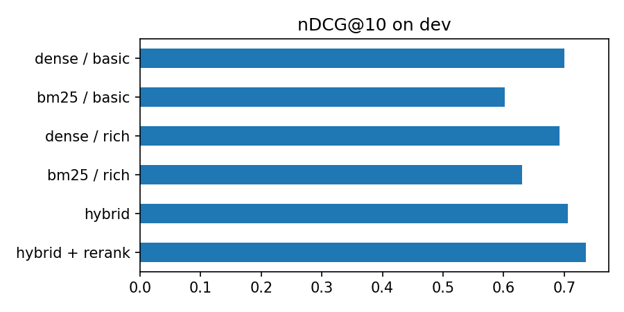

# Product search with hybrid retrieval, reranking and grounded LLM recommendations (WANDS)

Search and recommendations for an online home-goods store, evaluated against **human
relevance labels**: about 43k Wayfair products, 480 queries and 233k labels from the
[WANDS](https://github.com/wayfair/WANDS) dataset (Chen et al., ECIR 2022).

Two questions: (1) which retrieval setup finds the products people judged relevant, and is each
improvement bigger than noise? (2) can a small local LLM recommend from the top results without
inventing products or details?

All numbers below are from the **160 dev queries**. The 320 test queries have not been used yet.

## Part 1: retrieval

| Method | nDCG@10 | Recall@10 (Exact) | MRR | judged@10 | ~ms / query |
|---|---|---|---|---|---|
| Dense, name + description (baseline) | 0.700 | 0.275 | 0.518 | 0.842 | 22 |
| BM25, name + description | 0.602 | 0.259 | 0.466 | 0.781 | 41 |
| Dense, + category and features | 0.692 | 0.269 | 0.512 | 0.823 | 23 |
| BM25, + category and features | 0.630 | 0.250 | 0.492 | 0.799 | 52 |
| Hybrid (BM25 + dense, RRF) | 0.706 | 0.268 | 0.543 | 0.853 | 108 |
| **Hybrid + cross-encoder rerank** | **0.736** | **0.311** | **0.560** | 0.868 | 276 |

nDCG@10 gain over the baseline, 95% paired-bootstrap interval (10,000 resamples):

| Method | Gain | 95% CI | Real? |
|---|---|---|---|
| BM25 / basic | -0.098 | [-0.133, -0.065] | clearly worse |
| Dense / rich text | -0.007 | [-0.027, 0.012] | no difference |
| BM25 / rich text | -0.070 | [-0.106, -0.035] | clearly worse |
| Hybrid | +0.007 | [-0.018, 0.031] | no difference |
| **Hybrid + rerank** | **+0.037** | **[0.011, 0.063]** | **yes** |

- **Only the reranker gave a real gain**, at about 12x the latency of dense search.
- **Adding category and features to the product text did not help.** I expected it to.
- **Plain hybrid fusion did not beat dense search alone** (+0.007, inside the interval).
- BM25 alone is much weaker than the embedding model: queries and product text often use different words.

## Part 2: LLM recommendations

The top 8 products go to a local LLM (`qwen2.5:3b` via Ollama), which recommends up to 3.

- **v1:** dense search on name + description, free-text answer, product IDs read from the text.
- **v2:** hybrid + rerank on richer text, JSON answer (schema enforced by Ollama), IDs checked
  against the 8 candidates, and an explicit `nothing_fits` option.

| Dev (160 queries) | v1 | v2 |
|---|---|---|
| Retrieval nDCG@10 | 0.700 | 0.736 |
| Recommended products labelled **Exact** | 40.4% | **51.2%** |
| Recommended products Exact or Partial | 85.7% | 88.3% |
| Made-up product IDs (share of picks) | **0.4%** | 7.5% |
| Queries with no valid pick | 0% | 10.6% |
| Faithful reasons (LLM judge, **not validated**) | **95.6%** | 83.9% |
| Seconds per query, mean / p95 (Colab T4) | 4.3 / 5.3 | 2.9 / 4.0 |

Paired bootstrap (95% CI): Exact picks **+0.097 [0.043, 0.154]**, real. Exact-or-Partial picks
+0.015 [-0.024, 0.055], not distinguishable from zero.

### 
- v2 recommends more products that humans labelled **Exact**. Part of that comes from the better
  retrieval, so I cannot say how much is the prompt or the JSON format: v1 and v2 differ in
  retrieval, product text and answer format at the same time.
- **v2 made up more IDs than v1** (7.5% vs 0.4%) even with a JSON schema. The id check catches
  them, so they never reach the customer, but a 3B model does not stick to the list.
- **The faithfulness score dropped for v2** (83.9% vs 95.6%). Part of this is probably the made-up
  IDs: the answer text includes a reason for them, while the judge only sees the valid products.
  I have not validated the judge against my own labels yet, so I treat this number with caution.
- **"Nothing fits" is rarely used.** 57 of 160 dev queries had no Exact product among the 8 shown,
  but v2 said "nothing fits" for only 7 queries (5 of them correct, 2 wrong).
- Longer queries are harder: nDCG@10 is 0.82 for 1-2 word queries, 0.72 for 3-4 words and 0.67
  for 5+ words.
- Some queries have no good product in the catalog at all (for example "promo codes or discounts"),
  which no retrieval method can fix.

## How it works

| Step | What |
|---|---|
| Data | WANDS product, query and label files. Labels: Exact = 2, Partial = 1, Irrelevant = 0 |
| Product text | basic = name + description; rich = name + category + features + description |
| Dense | `BAAI/bge-small-en-v1.5`, normalized embeddings, cosine similarity |
| BM25 | `rank_bm25` on lowercase tokens without stopwords |
| Hybrid | Reciprocal Rank Fusion (k = 60) of BM25 and dense top-100 |
| Rerank | `cross-encoder/ms-marco-MiniLM-L-6-v2` on the top 50 hybrid results |
| LLM | `qwen2.5:3b` recommends, `qwen2.5:7b` judges faithfulness (temperature 0, fixed seed) |

## How it is evaluated
- **Human labels only** decide relevance (nDCG@10, Recall@10 of Exact, MRR, and the share of
  recommended products that humans labelled Exact). The LLM never decides relevance.
- **judged@10** is reported because WANDS labels are incomplete: unlabelled products count as irrelevant.
- **Fixed split:** 160 dev and 320 test queries in `split.json` (seed 42). The test queries are untouched.
- **Paired bootstrap** (10,000 resamples) for every comparison.
- The LLM judge is used only for faithfulness.

## Limitations
- Dev set only; test results are still to come.
- The faithfulness judge (`qwen2.5:7b`, same model family as the generator) is **not yet checked
  against hand labels**, and its score for v2 is probably affected by made-up IDs.
- v1 and v2 differ in several things at once, so the gain cannot be assigned to one change.
- WANDS labels are incomplete (judged@10 is 0.78 to 0.87).
- The reranker was trained on web question answering (MS MARCO), not on product search.
- One small generator model; all timings on a free Colab T4 GPU, one query at a time.

## Next
- Run the 320 test queries once and report them here.
- Label 30 judge answers by hand and report Cohen's kappa.
- Error analysis of the 20 worst queries by hand.

## Files

| File | What |
|---|---|
| [`01_retrieval_colab.ipynb`](01_retrieval_colab.ipynb) | retrieval methods, comparison and bootstrap (Colab, T4 GPU) |
| [`02_llm_colab.ipynb`](02_llm_colab.ipynb) | v1 and v2 recommendations, judge, comparison, demo (Colab, T4 GPU, Ollama) |
| [`shop_common.py`](shop_common.py) | data loading, product text, split, metrics |
| [`check_common.py`](check_common.py) | quick test of the shared code |
| `results/` | tables, rankings and LLM answers |

## Run it
1. Open `01_retrieval_colab.ipynb` in Google Colab with a T4 GPU and run all cells. Commit `results/` and `split.json`.
2. Open `02_llm_colab.ipynb` in Colab with a T4 GPU and run it. It installs Ollama and pulls `qwen2.5:3b` and `qwen2.5:7b`.
3. Locally: `pip install -r requirements.txt` and `python check_common.py`.

WANDS data (MIT license) is downloaded by the code and not stored in this repo.
